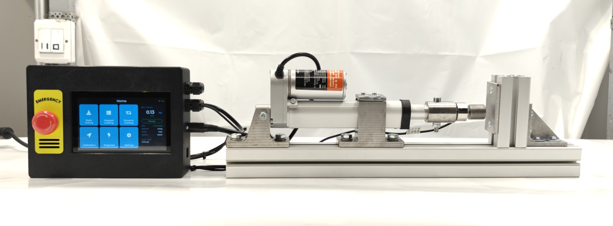
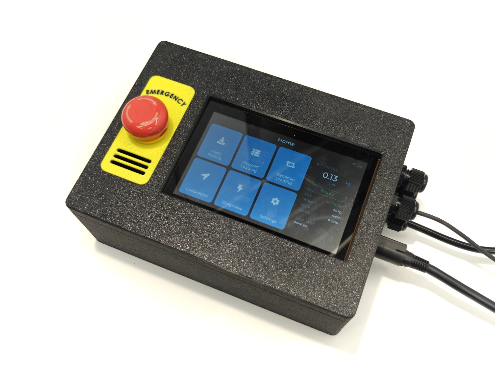
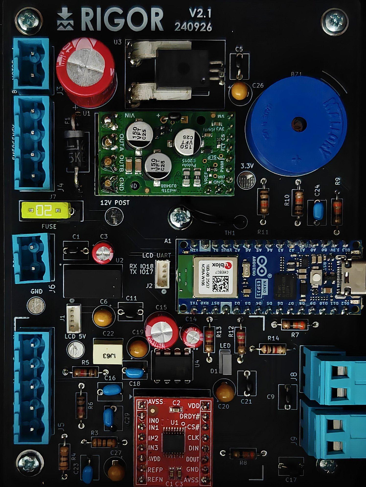

<p align="center">
  
</p>

<p align="center">
  <b>RIGOR: Reconfigurable Electrically Actuated Testing Rig for Compressive Loading</b><br>
  0–90 kg (≈ 883 N) · closed-loop force control on an in-line load cell · ISO 7500-1 class 1 measurement chain · ≈ €540 in parts
</p>

<p align="center">
  <!-- Replace XXXXXXX with the Zenodo DOI after the first release -->
  <a href="https://doi.org/10.5281/zenodo.xxxxx"></a>
  
  
  
</p>



RIGOR applies a commanded compressive force to a specimen and holds it, steps
through a programmed sequence, or cycles between two levels. A self-locking
12 V linear actuator is regulated on an in-line 100 kg load cell, read by a
ratiometric 24-bit ADC on a custom controller board. A 5-inch touchscreen runs
the tests, logs force against time to a microSD card and serves the logs over
Wi-Fi.

This repository holds what is needed to build, calibrate and run one: bill of
materials, CAD, PCB design and gerbers, firmware, the calibration workbook and
the analysis script behind the paper's figures and tables.

| | |
|---|---|
|  |  |

## Performance (as characterised)

| Characteristic | Result |
|---|---|
| Calibrated range | 10–90 kg |
| Measurement chain | ISO 7500-1 class 1 (worst indication error 0.74 %) |
| Command-to-achieved error | ≤ 0.30 % of full scale |
| Short-term repeatability | CV ≤ 0.35 % |
| Expanded uncertainty at 40 kg (k = 2) | 0.64 % indicated, 1.78 % generated force |
| Cyclic envelope (square wave) | up to 0.25 Hz |
| Protective functions | overload, overcurrent, over-temperature, end of travel, approach timeout, e-stop, link watchdog |

Method and full results: see [Citation](#citation).

## Repository layout

```
hardware/
  bom/             RIGOR_BOM.xlsx (+ BOM.csv): every part, price and supplier link
  mechanical/      SolidWorks CAD (zipped), drawings, 3MF files for the printed enclosure
  electronics/     KiCad project, gerbers (V2.1 as built, V2.2 current), datasheets
firmware/
  rig/             Control board (Arduino Nano ESP32): force loop and safety
  hmi/             Touchscreen (ESP32-S3, LVGL v8): UI, logging, Wi-Fi download
  tools/           Calibration harness and load-cell calibration sketches
calibration/       Calibration workbook and load-cell calibration data
analysis/          MATLAB script that regenerates the paper's figures and tables
docs/              Assembly, wiring, operation, serial protocol, safety, design parameters
photos/            Photographs of the built rig
```

## Getting started

1. **Source the parts** in [`hardware/bom`](hardware/bom).
2. **Make the custom parts** from [`hardware/mechanical`](hardware/mechanical)
   and order the PCB from [`hardware/electronics/gerbers`](hardware/electronics/gerbers).
3. **Assemble** following [`docs/assembly.md`](docs/assembly.md) and
   [`docs/wiring.md`](docs/wiring.md).
4. **Flash the firmware** following [`firmware/README.md`](firmware/README.md).
5. **Calibrate your load cell** following [`calibration/README.md`](calibration/README.md).
   The constants in the firmware belong to the authors' cell; yours will differ.
6. **Read [`docs/safety.md`](docs/safety.md)** before the first loaded run.

## Adapting the design

The frame is bolted T-slot profile, the load cell is M6-threaded at both ends
and the actuator family comes in several stroke and speed variants with the same
mounting. Test modes, limits and control parameters live in firmware.
[`docs/design_parameters.md`](docs/design_parameters.md) explains how to scale
each component to a different force range.

## Citation

If you use RIGOR or its data, please cite the paper and this repository.
Citation metadata is in [`CITATION.cff`](CITATION.cff) (GitHub shows a
"Cite this repository" button for it).

## Licence

| Part | Licence |
|---|---|
| Hardware design (CAD, drawings, PCB) | [CERN-OHL-P-2.0](LICENSES/CERN-OHL-P-2.0.txt) |
| Firmware and scripts | [MIT](LICENSES/MIT.txt) |
| Documentation, photos, data | [CC BY 4.0](LICENSES/CC-BY-4.0.txt) |

See [`LICENSE.md`](LICENSE.md). Third-party libraries and manufacturer
datasheets keep their own terms.

## Acknowledgements

Supported by the Finnish Ministry of Education and Culture's Pilot for Doctoral
Programmes (Pilot project Mathematics of Sensing, Imaging and Modeling).
Fabricated with the facilities of the Jamie Hyneman Center, LUT University,
Lappeenranta.

## Safety

This is a powered machine that stores mechanical energy in the specimen and the
load path. It is supplied as a research design without warranty. Read
[`docs/safety.md`](docs/safety.md).
