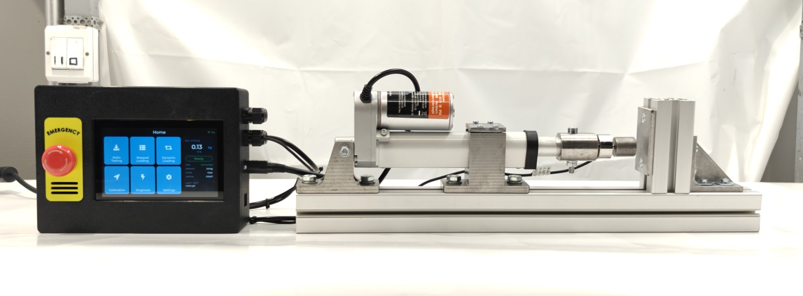
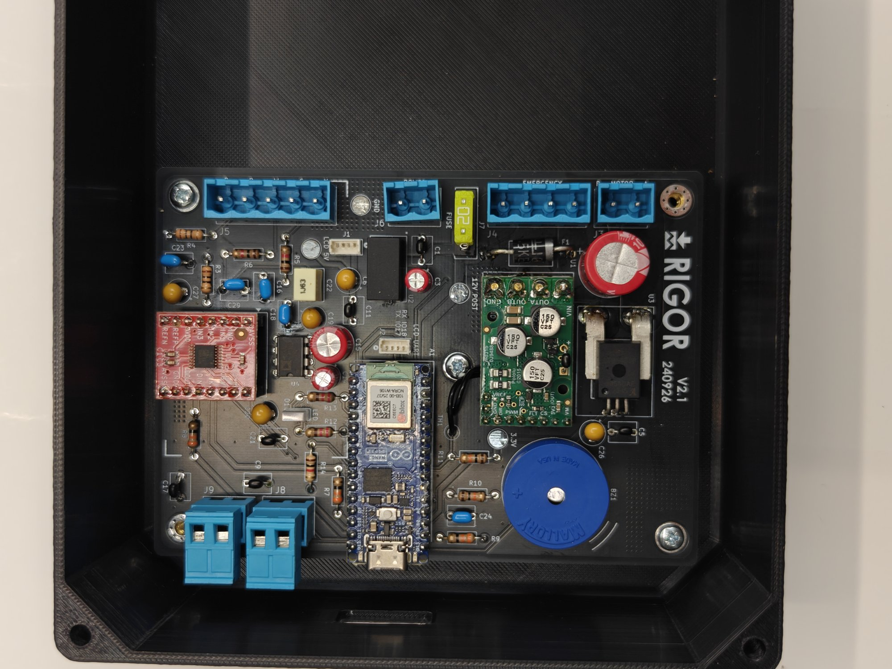

# Assembly

This guide describes the build as **sub-assemblies**, with the checks that
matter for force measurement. It assumes ordinary workshop skills; part IDs
refer to [`hardware/bom/RIGOR_BOM.xlsx`](../hardware/bom), and dimensions come
from the drawings and the CAD assembly in
[`hardware/mechanical`](../hardware/mechanical).

**Overview.** Force flows in one straight line: actuator rod → adaptor →
load cell → tup → specimen → reaction plate → frame. Everything about the
mechanical build serves two goals: keep that line **co-axial**, and keep the
frame **stiff** compared with the specimen.

---

## 1. Frame

1. Cut the base rail (E1) and the reaction post (E2) to length; deburr and square the ends.
2. Fix the reaction post upright at one end of the base rail with the two gussets (E3).
3. Check the post is square to the rail in both planes before final tightening.

## 2. Actuator sub-assembly

1. Fit the rear bracket (E4, *Actuator bracket 1*) and the front support (E5,
   *Actuator bracket 2* with *BracketLid*) to the base rail with
   T-slot nuts, finger-tight.
2. Mount the actuator (A1) by its rear eye in the rear bracket and clamp the body
   in the front support.
3. Extend the rod a few millimetres by hand power (12 V briefly to the motor
   leads) so it can be aligned later.

## 3. Load path

1. Thread the adaptor (E6, *LoadCellActuatorBracket*) onto the actuator rod and
   the load cell (A2) onto the adaptor; lock with an M6 jam nut (F3). Do not twist the cell by its body
   against a locked thread: hold the cell's hex or flats.
2. Thread the tup (E7, *LoadCellPusher*) into the free end of the load cell and lock it.
3. Fit the reaction plate (E8, *Force plate*) to the post so its face is perpendicular to the rail.
4. **Alignment check.** Slide the actuator assembly until the tup almost touches
   the reaction plate. The tup face should meet the plate centrally and flat. Adjust
   the brackets sideways and in height until it does, then tighten all T-slot fasteners.
   Off-axis load puts a bending moment on the cell, which it reads as force.
5. Route the load-cell cable with a strain-relief loop so it cannot pull on the cell.

## 4. Electronics enclosure

1. Order PCB V2.1 (B1) from the gerbers and solder the parts in sections B and C
   of the BOM. Plug in the Arduino Nano ESP32 (B2) and the Olimex ADC board (B3),
   and fit the motor driver (B4) with its thermistor (B8) bonded to it.
2. Print the enclosure body and lid (D2, files in `hardware/mechanical/3mf`) and
   fit the touchscreen (D1), the e-stop (D3), the power switch (D6), the cable
   glands (F5) and the power jack (D5).
3. Mount the PCB and make the internal connections listed in
   [`wiring.md`](wiring.md): supply, e-stop, motor driver, touchscreen UART.
4. Insert a FAT32 microSD card (F8) in the touchscreen.

## 5. Connect enclosure and rig

Run the actuator cable (motor leads and limit switches, if separate) and the
4-wire load-cell cable through the glands to the PCB connectors. Keep the
load-cell cable away from the motor leads. Connections: [`wiring.md`](wiring.md).

## 6. Firmware

Flash both boards as described in [`firmware/README.md`](../firmware/README.md).

## 7. First power-up checks (no specimen)

| Check | Expected |
|---|---|
| Power on with e-stop pressed | Touchscreen shows the e-stop overlay; actuator cannot move |
| Release e-stop, reset on screen | Status *Ready* |
| Unloaded force reading | Within a few tenths of a kg of zero, stable to ~0.01 kg |
| Jog + / − on the Static screen | Rod extends / retracts; direction matches the labels |
| Press the load cell lightly by hand | Reading increases (positive in compression) |
| Run to each end of stroke | Motion stops at the limit; no fault besides end of travel |
| Unplug the UART cable during a slow move | Rig stops on its own within ~5 s |

If force goes negative in compression, swap the load-cell signal pair (S+/S−).
If jog directions are reversed, swap the motor leads.

## 8. Calibrate and tare

Follow [`calibration/README.md`](../calibration/README.md), then tare the
installed cell from the Calibration screen.
