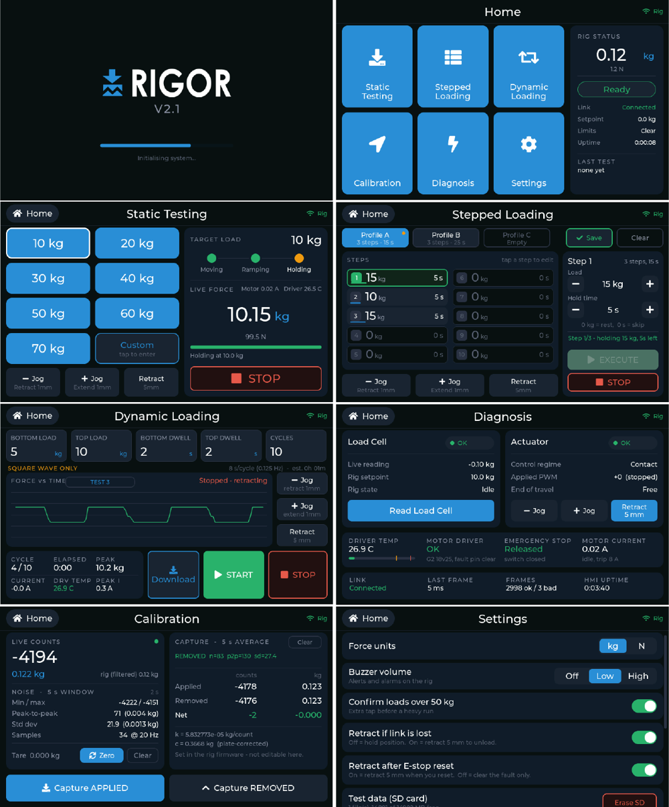

# Operation

## Screens

| Screen | Use |
|---|---|
| Home | Live force, rig state, link status, last test |
| Static Testing | Go to one force and hold it; preset or keypad set-point |
| Stepped Loading | A programmed sequence of force levels and dwell times; live force shown |
| Dynamic Loading | Square-wave cycling between two levels; named CSV log |
| Calibration | Live raw counts, averaging capture, tare |
| Diagnosis | Load cell, actuator, driver temperature, current, e-stop, link |
| Settings | Units, buzzer volume, confirmations, auto-retract on link loss / e-stop reset, Wi-Fi download |

## Running a test

1. Fit the specimen against the reaction plate. Retract first if needed.
2. Choose the mode and set-point(s). Loads above 50 kg ask for confirmation
   (can be disabled in Settings).
3. Start. The rig approaches at low speed, closes the loop on contact
   (> 1.5 kg) and settles within ±0.4 kg.
4. Stop at any time with **STOP** on screen or the e-stop.

## Getting the data

Logs are written to the microSD card as CSV, one file per test. To download them
without removing the card, enable Wi-Fi in Settings, join the network shown on
the screen with a phone or laptop and open the address shown in a browser.

## Limits of use

- Compression only, 0–90 kg commanded (software cap); overload trips at 95 kg.
- Quasi-static and slow cyclic loading up to about 0.25 Hz.
- No displacement measurement.
- Respect the actuator's 25 % duty cycle on long cyclic tests.
