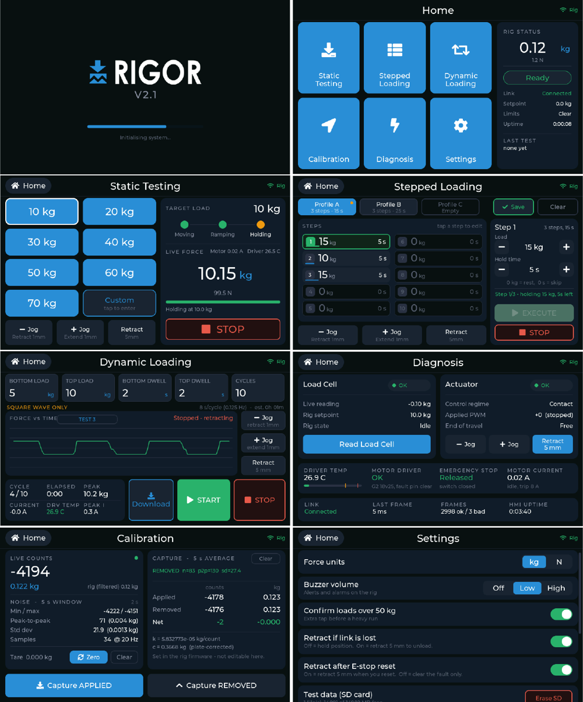

# RIGOR touchscreen firmware (v1.3.1)

User interface for the RIGOR rig, written in plain LVGL v8 C++ for the
**Sunton ESP32-8048S050** (ESP32-S3, 5-inch 800×480 RGB panel, GT911
capacitive touch, microSD slot). It sequences the tests, shows live force,
logs force against time to the microSD card and serves the logs over its own
Wi-Fi access point. It drives the rig over UART; it does not control the
actuator itself.



Design mock-ups of every screen are in [`mockups/`](mockups).

## Libraries (Arduino Library Manager)

| Library | Version used |
|---|---|
| esp32 board package (Espressif) | TBC |
| ESP32_Display_Panel | TBC |
| ESP32_IO_Expander | TBC |
| esp-lib-utils | TBC |
| lvgl | 8.x (TBC) |

SD, SPI, WiFi and WebServer come with the esp32 board package.

## Configuration files

| File | Where it goes |
|---|---|
| `lv_conf.h` | Copy to your Arduino **libraries** folder, next to the `lvgl` folder (e.g. `Documents/Arduino/libraries/lv_conf.h`). LVGL reads it from there, not from the sketch folder. It enables the Montserrat fonts the UI uses and `LV_USE_SNAPSHOT`. |
| `esp_panel_board_custom_conf.h`, `esp_panel_board_supported_conf.h`, `esp_panel_drivers_conf.h`, `esp_utils_conf.h` | Stay in the sketch folder. They describe the Sunton ESP32-8048S050 (ST7262 RGB panel, GT911 touch). |
| `lvgl_v8_port.h/.cpp` | Stay in the sketch folder (LVGL port from the ESP32_Display_Panel examples). |

## Board settings (Tools menu)


| Setting | Value |
|---|---|
| Board | ESP32S3 Dev Module |
| USB CDC On Boot | **Enabled** (required) |
| CPU Frequency | 240 MHz |
| Flash Mode | QIO 80 MHz |
| Flash Size | 8 MB (16 MB on N16R8 modules) |
| PSRAM | **OPI PSRAM** (required) |
| Partition Scheme | 8M with spiffs (3MB APP) or Huge APP |
| Arduino Runs On / Events On | Core 1 |
| Upload Speed | 921600 (115200 if uploads fail) |
| USB Mode | Hardware CDC and JTAG |

## Options in the source

| Where | Option |
|---|---|
| `TouchScreenESP32Firmware.ino`, line 80 | `lv_disp_set_rotation(..., LV_DISP_ROT_180)`: the panel is mounted upside down in the enclosure. Remove for a normal mounting. |
| `TouchScreenESP32Firmware.ino` | `ENABLE_SCREENSHOTS` (default 0). With 1, typing `p` in the serial monitor saves the screen as a BMP to `/shots` on the SD card. |
| `src/app/webserver.h` | Wi-Fi access-point name and password. **Change the password.** |
| `src/link/link.cpp` | UART pins (TX GPIO 17, RX GPIO 18) and baud rate. Do not use GPIO 43/44: the ESP32-S3 boot log appears there. |
| `src/ui/ui.h` | `HMI_FW_VERSION`, shown on the About screen and the download page. |

## Source layout

```
TouchScreenESP32Firmware.ino   board and LVGL bring-up, backlight, main loop
src/app/    state (shared rig state), datalog (microSD), webserver (Wi-Fi download),
            screenshot, hal (backlight hook)
src/link/   UART link to the rig: commands out, telemetry in, reconnect handling
src/ui/     screens (splash, home, static, stepped, dynamic, calibration,
            diagnosis, settings, about), theme, widgets, e-stop overlay, logo
```

Build and design notes: [`BUILD_NOTES.md`](BUILD_NOTES.md).
