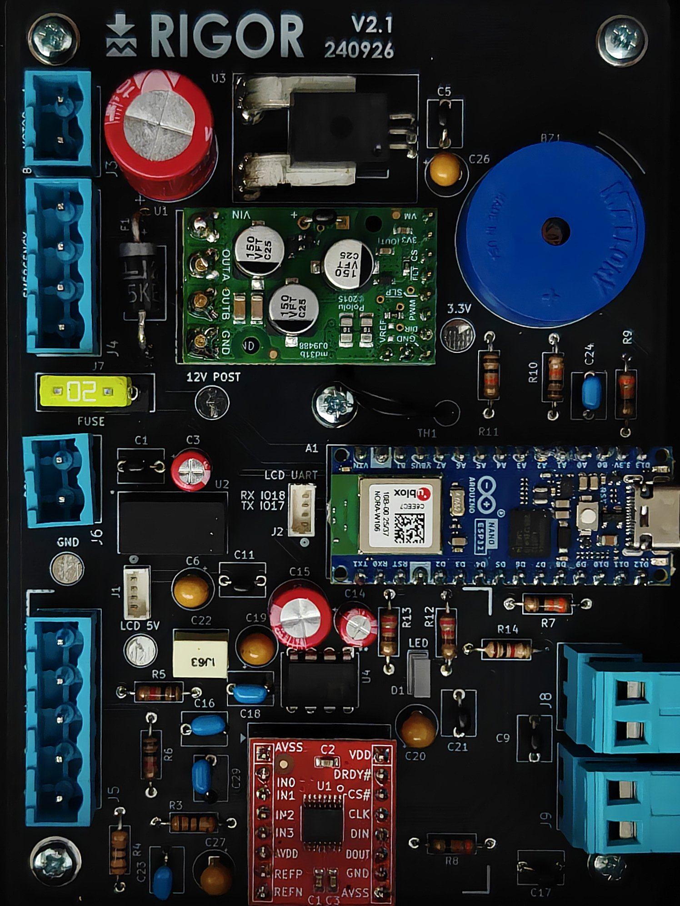

# Electronics

The controller PCB carries the Arduino Nano ESP32, the Olimex BB-ADS1220
load-cell ADC, the ACS773 current sensor, the Pololu G2 18v25 motor driver,
the driver thermistor, buzzer, status LED and the connectors for the
actuator, load cell, e-stop, supply and touchscreen.

## Board revisions

| Revision | Silkscreen | Status | Files |
|---|---|---|---|
| **V2.1** | `V2.1 240926` | **Built and characterised in the paper** | [`gerbers/RIGOR_PCB_V2.1_gerbers.zip`](gerbers) |
| V2.2 | `V2.2 151026` | Current KiCad project; touchscreen UART connector J2 re-pinned. Not yet fabricated or tested. | [`kicad/Force_Rig_PCB_V2`](kicad/Force_Rig_PCB_V2), [`gerbers/RIGOR_PCB_V2.2_gerbers.zip`](gerbers) |

To reproduce the rig as published, order **V2.1**. Check J2 against
[`../../docs/wiring.md`](../../docs/wiring.md) if you build V2.2.

## Contents

| Path | Contents |
|---|---|
| [`kicad/Force_Rig_PCB_V2/`](kicad/Force_Rig_PCB_V2) | KiCad project (schematic, layout, project libraries), PCB renders, current calculations, 3D model of the board in its enclosure |
| [`gerbers/`](gerbers) | Fabrication files, one zip per revision, ready to upload to a PCB fab (built with JLCPCB) |
| `Force_Rig_PCB_schematic.pdf` | Schematic for reading without KiCad (in `kicad/Force_Rig_PCB_V2/`) |
| [`datasheets/`](datasheets) | Datasheets and vendor documents for the main parts |

Board-to-board and off-board wiring: [`../../docs/wiring.md`](../../docs/wiring.md).
Component list with prices: [`../bom`](../bom).

## Next revision

- Keep the Nano ESP32's Wi-Fi antenna clear of copper pours and the enclosure wall.
- Print component values on the silkscreen.
